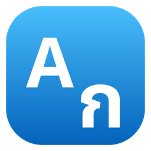
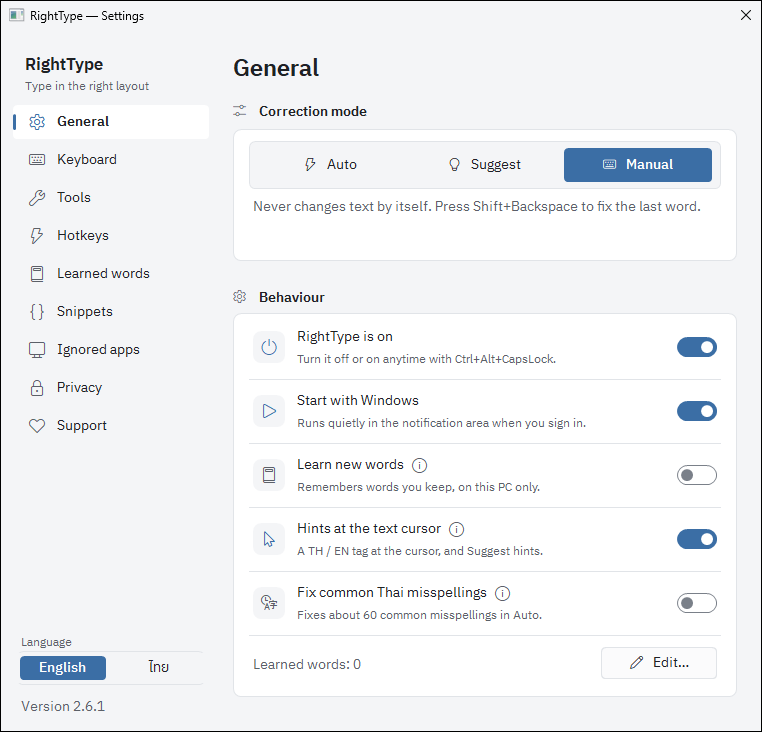
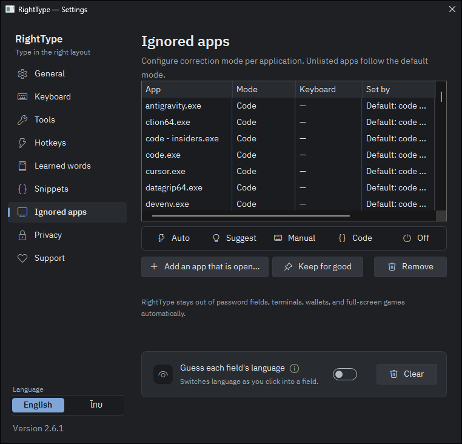
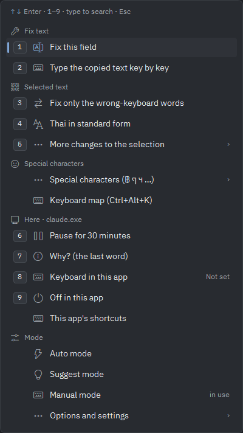

<div align="center">



# RightType

### พิมพ์ผิดภาษา แก้ให้เอง

แปลงข้อความที่พิมพ์ผิดคีย์บอร์ด ไทย ↔ อังกฤษ กลับให้ถูกต้อง โดยไม่ต้องลบแล้วพิมพ์ใหม่

~~แนพพำแะ~~ → **correct**  ·  ~~l;ylfu~~ → **สวัสดี**

[](https://github.com/k-affan-th/RightType/releases/latest)
[](https://github.com/k-affan-th/RightType/releases)
[](https://github.com/k-affan-th/RightType/actions/workflows/rust.yml)
[](https://github.com/k-affan-th/RightType/stargazers)
<br>


[**ดาวน์โหลด**](https://github.com/k-affan-th/RightType/releases/latest) ·
[เริ่มใช้](#เริ่มใช้ใน-3-นาที) ·
[ต่างจากตัวอื่น](#ต่างจากตัวอื่นตรงไหน) ·
[ผู้ใช้ขั้นสูง](#สำหรับผู้ใช้ขั้นสูง) ·
[นักพัฒนา](#สำหรับนักพัฒนา) ·
[คู่มือฉบับเต็ม](docs/GUIDE.md)

</div>

---

*English: RightType fixes text typed in the wrong keyboard layout (Thai typed while
English is active, or the other way round) without retyping. Free, open source,
no network code. Quick start below; power-user and developer sections further
down; the full guide is in [docs/GUIDE.md](docs/GUIDE.md).*

| ตั้งค่า | แต่ละแอปตั้งโหมดได้ | Command palette |
| --- | --- | --- |
|  |  |  |

---

## เริ่มใช้ใน 3 นาที

> สำหรับทุกคน ไม่ต้องรู้เรื่องเทคนิคอะไรเลย

**1. ติดตั้ง**

1. ดาวน์โหลด `RightType-<เวอร์ชัน>-setup.exe` จากหน้า
   [Releases ล่าสุด](https://github.com/k-affan-th/RightType/releases/latest)
2. ดับเบิลคลิก ถ้า Windows ขึ้น "Windows protected your PC" ให้กด **More info → Run anyway**
   (ไฟล์ยังไม่ได้ลงลายเซ็นดิจิทัล จึงขึ้นคำเตือนนี้ทุกครั้ง) ไม่ต้องใช้สิทธิ์ admin
3. RightType อยู่ที่มุมขวาล่างของจอ (ไอคอน **Aก**) คลิกเพื่อเปิดเมนูและหน้าตั้งค่า

อยากตรวจว่าไฟล์ไม่เสียหายระหว่างโหลด? เทียบกับ `SHA256.txt` ในหน้าเดียวกัน:

```powershell
Get-FileHash -Algorithm SHA256 .\RightType-<เวอร์ชัน>-setup.exe
```

**2. ลองใช้**

พิมพ์ตามปกติ พอเห็นว่าพิมพ์ผิดภาษา กด **`Shift` + `Backspace`** ครั้งเดียว
คำล่าสุดจะถูกแก้ให้ทันที กดซ้ำเพื่อแก้คำก่อนหน้าได้อีก (สูงสุด 8 คำ)
ถ้าแก้แล้วไม่ใช่ที่ต้องการ กดอีกครั้งเพื่อย้อนกลับ

**3. อยากให้แก้เองโดยไม่ต้องกด?**

คลิกไอคอนที่มุมขวาล่าง แล้วเลือกโหมด:

| โหมด | เหมาะกับ | เกิดอะไรขึ้น |
| --- | --- | --- |
| **Manual** (ค่าเริ่มต้น) | คนที่อยากคุมเอง | แก้เมื่อคุณกด `Shift`+`Backspace` เท่านั้น |
| **Suggest** | อยากให้ช่วยแต่ไม่อยากให้แตะข้อความเอง | แสดงคำที่แก้แล้วข้างเคอร์เซอร์ กด `Tab` เพื่อใช้ |
| **Auto** | พิมพ์เยอะและพิมพ์ผิดภาษาบ่อย | แก้และสลับภาษาให้เองทันที |

เปลี่ยนโหมดได้ทุกเมื่อด้วย `Ctrl`+`CapsLock` เท่านี้ก็ใช้งานได้แล้ว
หน้าตั้งค่ามีภาษาไทยและอังกฤษ และเปลี่ยนตามธีมสว่าง/มืดของ Windows

---

## ต่างจากตัวอื่นตรงไหน

| | | |
| --- | --- | --- |
| **แก้แล้วไม่เพี้ยน** | ใส่ตัวอักษรที่ถูกให้ทีเดียว ไม่เล่นปุ่มซ้ำ จึงไม่มี `ggg…` โผล่ และไม่ตกหล่นใน Word | [ที่มา](docs/GUIDE.md#why-a-rebuild) |
| **ตื่นแล้วทำต่อ** | เครื่องหลับหรือล็อกจอแล้วกลับมา ยังทำงานเองได้ ไม่ต้องปิดเปิดโปรแกรม | [ที่มา](docs/GUIDE.md#why-a-rebuild) |
| **ไม่แก้คำที่ถูกให้ผิด** | ทดสอบกับคำไทย 60,964 คำและวลี 200,000 วลีที่พิมพ์ถูก แปลงผิด 0 | [ผลทดสอบ](docs/TYPING_BENCHMARK.md) |
| **ไม่ออกเน็ต** | ไม่มีโค้ดเครือข่าย ปิดเองในช่องรหัสผ่าน ไม่ต้องใช้สิทธิ์ admin | [Threat model](docs/THREAT_MODEL.md) |

## ความเป็นส่วนตัว

โปรแกรมคีย์บอร์ดเห็นทุกอย่างที่คุณพิมพ์ RightType จึงออกแบบให้ไว้ใจได้:

- **ไม่มีโค้ดเครือข่าย** ไม่มี telemetry ตรวจได้จาก `Cargo.lock`
- **ไม่บันทึกสิ่งที่พิมพ์ลงดิสก์** เก็บแค่คำที่กำลังพิมพ์ในหน่วยความจำ แล้วล้างทิ้ง
- **ปิดตัวเอง** ในช่องรหัสผ่าน, password manager, กระเป๋าคริปโต, terminal, remote desktop และเกมเต็มจอ
- **ไม่ต้องใช้สิทธิ์ admin**

รายละเอียด: [Privacy & security](docs/GUIDE.md#privacy--security-built-for-sensitive-typing)
และ [Threat model](docs/THREAT_MODEL.md)

---

## สำหรับผู้ใช้ขั้นสูง

> ถ้าคุณใช้ RightType ทุกวัน อยากปรับให้เข้ามือ ส่วนนี้คือของเล่นของคุณ
> แต่ละหัวข้อกดเปิดอ่านได้ ทั้งหมดอยู่ใน Settings หรือเรียกด้วยปุ่มลัด

<details>
<summary><b>ปุ่มลัด</b> (ตั้งใหม่ได้ทั้งหมดที่ Settings → Hotkeys)</summary>

| ปุ่ม | ทำอะไร |
| --- | --- |
| `Shift`+`Backspace` | แก้คำล่าสุดในที่เดิม กดซ้ำเพื่อแก้ย้อนไปได้ถึง 8 คำ ค้างไว้เพื่อแก้ที่เหลือทีเดียว |
| `Shift`+`CapsLock` | แก้ข้อความที่เลือกอยู่ (อ่านผ่าน UI Automation ไม่ผ่านคลิปบอร์ด) |
| `Ctrl`+`CapsLock` | สลับโหมด Manual → Auto → Suggest |
| `Tab` / `Alt`+`CapsLock` | ใช้คำแนะนำของ Suggest |
| `Ctrl`+`Shift`+`CapsLock` | ย้อนการแก้ครั้งล่าสุด |
| `Ctrl`+`Alt`+`CapsLock` | เปิด/ปิด RightType ทันที |
| `Ctrl`+`Alt`+`Space` | Command palette: คำที่เพิ่งพิมพ์, ซ่อมทั้งช่อง, พ.ศ. ↔ ค.ศ., จำนวนเงินเป็นตัวหนังสือ, ตัวอักษรพิเศษ, พิมพ์ข้อความที่คัดลอกทีละปุ่ม (remote desktop/VM) และอื่น ๆ |
| `Shift` สองครั้ง | รายการที่เคอร์เซอร์: ค้นหาอักขระตามชื่อ, Snippets, คำสั่งของแอป |
| `Ctrl`+`Backspace` | หลังพิมพ์ไทย ลบทีละคำไทย |
| `Ctrl`+`Alt`+`K` | แผนผังคีย์บอร์ด คลิกปุ่มเพื่อพิมพ์ |

</details>

<details>
<summary><b>โหมดแยกตามแอป</b></summary>

Settings → Apps เป็นตารางของทุกแอปที่ตั้งโหมดเฉพาะไว้ คลิกขวาที่แถวเพื่อเปลี่ยน
**Code mode** เป็นค่าเริ่มต้นในตัวแก้โค้ด: ไม่แตะชื่อตัวแปร และให้ภาษาไทยเฉพาะใน
คอมเมนต์และสตริง ส่วนแอปแชท (LINE, Teams, Discord, Slack, Telegram ฯลฯ) มีตัวกันพลาด:
ถ้ากด Enter ในข้อความที่ดูเหมือนพิมพ์ผิดคีย์บอร์ดทั้งประโยค จะถูกพักไว้ครั้งเดียวพร้อมข้อความเตือน
กด Enter อีกครั้งจึงส่ง (เปิดไว้ให้แล้ว เพิ่มแอปได้ใน `chat_apps` ของ config) มีตัวเลือก **เดาภาษาของแต่ละช่อง** (ปิดไว้ก่อน) ที่สลับคีย์บอร์ดให้เมื่อคุณคลิกเข้าช่องที่ใช้ภาษาเดียวเสมอ
โดยเก็บแค่จำนวนคำ ไม่เก็บเนื้อหา

</details>

<details>
<summary><b>Snippets และ Macros</b></summary>

พิมพ์ตัวย่อ เช่น `;addr` แล้วเว้นวรรค จะกลายเป็นข้อความยาว ตั้งให้ใช้กับแป้นไทย แป้นอังกฤษ หรือทั้งสอง
Macro ใส่ขั้นตอนได้ เช่น `{กด Ctrl+B}`, `{รอ 300}`, `{คำสั่ง ตัวหนา}`, `{สไตล์ Heading 1}`, `{คลิปบอร์ด}`

</details>

<details>
<summary><b>สูตรคณิตศาสตร์และตัวอักษรพิเศษ</b></summary>

- เขียนสูตรเป็นคำพูด (ไทยหรืออังกฤษ), แบบย่อเหมือน equation editor ของ Word (`x^(3/2) + (2x)/8`) หรือ LaTeX
  ได้เป็น Unicode ทุกที่ หรือเป็นสมการจริงใน Word / PowerPoint / OneNote
- **Ghost suggestions**: `->`, `!=`, `x^2`, `\alpha` แสดงสิ่งที่จะกลายเป็น กด `Tab` เพื่อเขียน
- แตะ `Right Alt` หลังตัวอักษรเพื่อดูแบบอื่น (`e` → é è ê ë) กด `Ctrl`+`P` เพื่อปักไว้ที่ปุ่ม

</details>

<details>
<summary><b>คำที่จำไว้ ซิงก์ และพกพา</b></summary>

- **Learn new words** (ปิดไว้ก่อน): คำอังกฤษที่พิมพ์ครบ 3 ครั้ง และคำที่คุณกดแก้กลับ จะถูกจำและใช้ทันที
- นำเข้า/ส่งออกคำ หรือเก็บรายการ (กับการตั้งค่าและ snippets ถ้าต้องการ) ไว้ในโฟลเดอร์ซิงก์ เช่น OneDrive
- **Portable**: วางไฟล์ว่างชื่อ `portable` ข้าง `righttype.exe` ค่าและคำที่เรียนรู้จะอยู่ในโฟลเดอร์ `data` ข้างกัน เหมาะกับ USB
- ตั้งค่าเพิ่มเติมได้ใน `config.toml` เช่น `selection_via_clipboard = true`

</details>

<details>
<summary><b>แป้นพิมพ์ที่รองรับ (ตรวจให้อัตโนมัติ)</b></summary>

RightType ดูจากแป้นที่ Windows ใช้อยู่ตอนนั้น ไม่ต้องตั้งค่าเอง (แป้นที่เพิ่งติดตั้งต้องเปิดโปรแกรมใหม่)

| ภาษา | แป้น |
| --- | --- |
| ไทย | Kedmanee, Pattachote, Manoonchai |
| อังกฤษ | US, UK (ของทุกประเทศที่ใช้แป้น US/UK), Dvorak, Colemak |

Dvorak และ Colemak แก้คำที่พิมพ์ผิดภาษาได้ทั้งสองทิศ แต่หน้าฝึกพิมพ์และแผนผังแป้นยังแสดงแป้น US
แป้นที่ไม่อยู่ในตาราง เช่น Dvorak มือซ้าย/ขวา, Colemak-DH, แป้นเยอรมัน/ฝรั่งเศส RightType จะหยุดทำงานตอนใช้แป้นนั้น
เพราะไม่เดา (เดาผิดคือพิมพ์เสีย) ตารางเต็มอยู่ใน [คู่มือ](docs/GUIDE.md)

</details>

<details>
<summary><b>เครื่องมือคีย์บอร์ด</b></summary>

ฝึกพิมพ์ Kedmanee / Pattachote / Manoonchai (รอบ 60 วินาที และเกมคำตก), ทดสอบปุ่ม, ตรวจปุ่มค้าง / Sticky Keys,
ทำความสะอาดคีย์บอร์ด, ดูปุ่มลัดของแอปปัจจุบัน, แสดงปุ่มบนจอสำหรับอัดคลิป, เตือนพัก, หน้าสถิติรายสัปดาห์
(เก็บแค่ตัวนับ ไม่เก็บสิ่งที่พิมพ์)

</details>

อ่านครบทุกอย่างได้ที่ [คู่มือฉบับเต็ม](docs/GUIDE.md) และดู [Undo](docs/UNDO.md)
ว่าการย้อนกลับทำงานอย่างไร

---

## สำหรับนักพัฒนา

> RightType เขียนด้วย Rust แยกตรรกะหลักที่ไม่พึ่ง OS ออกจากชั้นเชื่อมต่อ Windows

```sh
cargo test                                   # ตรรกะหลัก รันได้ทุก OS
cargo run --features winos                   # แอปเต็มบน Windows
cargo build --release --features winos
pwsh -File packaging\build_release.ps1       # installer + zip + SHA256.txt ลง dist\
```

- ต้องมี Rust toolchain แบบ MSVC และ Visual Studio C++ Build Tools (Rust 1.75+)
- โครงสร้าง: แกนหลัก (`layout`, `secret`, `dict`, `detect`, `segment`, `buffer`) ไม่เรียก OS ทดสอบได้ทุกที่
  ส่วน Windows (`hook`, `inject`, `manual`, `safety`, `focus`, `tray`, …) อยู่หลัง feature `winos`
- วัดความแม่นและความเร็ว: `cargo run --release --example typing_benchmark` และ
  `cargo run --release --example false_positive_audit` ผลอยู่ใน [Typing benchmark](docs/TYPING_BENCHMARK.md)
- เปิดหน้าต่างเดียวเพื่อดูตอนพัฒนา (debug build): `RIGHTTYPE_SHOW=settings` หรือ `settings-hotkeys`, `settings-about`, `settings-sponsor` ฯลฯ
- ออกรุ่นไม่ต้องใช้เครื่อง Windows: แก้ `version` ใน `Cargo.toml` เพิ่มหัวข้อใน `CHANGELOG.md`
  merge เข้า `main` แล้วรัน **Actions → Release**
- ความปลอดภัย: [Threat model](docs/THREAT_MODEL.md)

---

## อ่านต่อ

| คุณคือ | อ่านอะไร |
| --- | --- |
| **ผู้ใช้ทั่วไป** | [เริ่มใช้ใน 3 นาที](#เริ่มใช้ใน-3-นาที) · [ความเป็นส่วนตัว](#ความเป็นส่วนตัว) |
| **ผู้ใช้ขั้นสูง** | [สำหรับผู้ใช้ขั้นสูง](#สำหรับผู้ใช้ขั้นสูง) · [คู่มือฉบับเต็ม](docs/GUIDE.md) · [Undo](docs/UNDO.md) |
| **นักพัฒนา** | [สำหรับนักพัฒนา](#สำหรับนักพัฒนา) · [Typing benchmark](docs/TYPING_BENCHMARK.md) · [Threat model](docs/THREAT_MODEL.md) |
| **ตามความเปลี่ยนแปลง** | [Changelog](CHANGELOG.md) |

ติดตั้งแบบอื่น (Windows on ARM, portable zip, ตรวจ SHA256, ถอนการติดตั้ง):
[Install ในคู่มือฉบับเต็ม](docs/GUIDE.md#install-no-building-needed)

## สนับสนุน

RightType ฟรีและเปิดซอร์ส ทุกฟีเจอร์ใช้งานฟรี 100% หากช่วยให้งานคุณสะดวกขึ้น ร่วมสนับสนุนค่ากาแฟได้ตามสะดวก
หรือร่วมพัฒนาได้ที่ [GitHub](https://github.com/k-affan-th/RightType)

| PromptPay | Lightning | Bitcoin |
| :---: | :---: | :---: |
|  |  |  |
| `004-666-008749073` (e-Wallet) · สแกนด้วยแอปธนาคารไทย | `yawninggrass92@walletofsatoshi.com` | `bc1qdac8h7hl57x3kv8x8xpz6zg0fgw6zvp7uld3a6` |

## License

MIT หรือ Apache-2.0 ตามที่คุณเลือก — ดู [LICENSE-MIT](LICENSE-MIT) และ [LICENSE-APACHE](LICENSE-APACHE)


## Code Signing

Free code signing provided by [SignPath.io](https://signpath.io), certificate by [SignPath Foundation](https://signpath.org).
