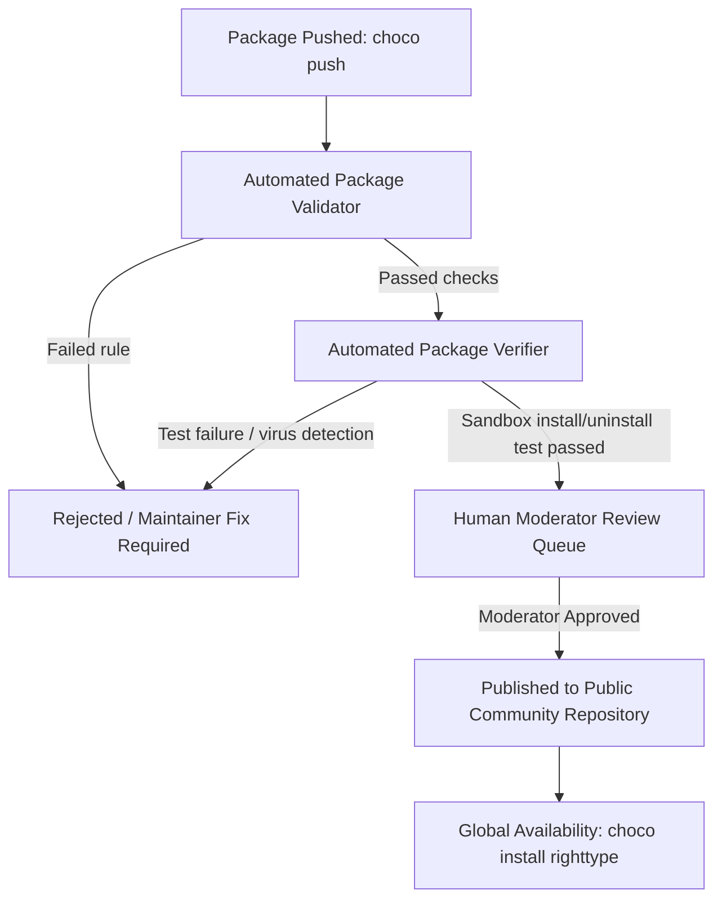

# RightType Package Managers & Distribution Submission Guide

> **Maintainer Guide:** Step-by-step operational instructions for publishing and maintaining RightType across **winget**, **Scoop**, and **Chocolatey**, along with the Phase 2 roadmap for the **Microsoft Store (MSIX)**.

---

## 1. Overview & Pre-requisites

RightType is distributed through three primary Windows package managers to ensure frictionless discovery, installation, and background updates for both desktop users and developers:

| Channel | Target Audience | Package Identifier | Source Artifacts | Elevation Required |
| :--- | :--- | :--- | :--- | :--- |
| **winget** | Windows 10/11 default package manager | `k-affan-th.RightType` | Inno Setup (`-setup.exe`, x64 + ARM64) | No (`user` scope) |
| **Scoop** | Developers, command-line power users | `righttype` | Portable ZIP (`.zip`, x64 + ARM64) | No (`%LOCALAPPDATA%`) |
| **Chocolatey** | IT admins, automation scripts, CI/CD | `righttype` | Inno Setup (`-setup.exe`, x64) | No (`user` scope) |

### 1.1 Release Asset Pre-conditions

Before submitting packages for a release (e.g. `v2.6.3`), verify that the following release assets are published and publicly accessible on the [GitHub Releases](https://github.com/k-affan-th/RightType/releases) page:

1. `RightType-2.6.3-setup.exe` (x64 Inno Setup installer)
2. `RightType-2.6.3-arm64-setup.exe` (ARM64 Inno Setup installer)
3. `RightType-2.6.3-x64.zip` (x64 portable archive)
4. `RightType-2.6.3-arm64.zip` (ARM64 portable archive)
5. `SHA256.txt` (Reference checksum list for all release binaries)

> [!NOTE]
> Inno Setup installer metadata:
> - **AppId**: `{8C6B9A2E-52C1-4E63-9B7A-7C1F4A2B9D33}`
> - **ProductCode**: `{8C6B9A2E-52C1-4E63-9B7A-7C1F4A2B9D33}_is1`
> - **Silent Install Arguments**: `/VERYSILENT /SUPPRESSMSGBOXES /NORESTART /SP-`
> - **Install Scope**: Per-user (`{autopf}\RightType`), no administrative privileges required.

---

### 1.2 Unified Package Verification

Before submitting any manifest or package upstream, execute the repository's unified package verification script. This script automatically runs all manifest generators, verifies SHA-256 hashes against release assets, checks JSON and YAML schema compliance, validates Inno Setup silent flags, and runs `winget validate` if `winget` is installed locally:

```powershell
# From the RightType repository root:
pwsh -File packaging/verify_packages.ps1 -Version 2.6.3
```

**Expected Output:**

```text
========================================================================================
                             Verification Summary
========================================================================================
Channel       Status    Notes
----------------------------------------------------------------------------------------
winget        PASS      3 manifests present; x64/arm64 verified; winget CLI validate passed
scoop         PASS      JSON schema valid; x64/arm64 hashes verified; bin & shortcuts match
chocolatey    PASS      nuspec valid; tools & silent args verified; nupkg built
----------------------------------------------------------------------------------------
 Result: ALL PASS (3/3 channels verified successfully)
========================================================================================
```

Do not proceed with upstream submissions until all three channels report `PASS`.

---

## 2. winget Submission Guide

winget is Microsoft's official Windows Package Manager client (`winget.exe`). RightType manifests follow the official `winget-cli` multi-manifest specification (schema version `1.6.0`).

### 2.1 Manifest Artifacts

The generator produces three files in `dist/winget/2.6.3/`:
1. `k-affan-th.RightType.yaml` (Version manifest: PackageIdentifier, PackageVersion, DefaultLocale)
2. `k-affan-th.RightType.installer.yaml` (Installer manifest: Architecture entries for `x64` and `arm64`, Inno Setup switch table, SHA256 hashes, ProductCode)
3. `k-affan-th.RightType.locale.en-US.yaml` (Locale manifest: Publisher, PackageName, License, Short/Full Description, Tags, Moniker)

```powershell
# If re-generating manifests individually:
pwsh -File packaging/winget.ps1 -Version 2.6.3 -Out dist/winget
```

There are two methods to submit RightType manifests to the official [microsoft/winget-pkgs](https://github.com/microsoft/winget-pkgs) repository:

---

### 2.2 Method A: Automated Submission via `wingetcreate` (Recommended)

`wingetcreate` is Microsoft's official CLI tool for packaging and submitting manifests directly to `microsoft/winget-pkgs`.

#### Step 1: Install `wingetcreate`

```powershell
winget install Microsoft.WingetCreate
```

Or download the latest release binary from [microsoft/winget-create](https://github.com/microsoft/winget-create/releases).

#### Step 2: Generate a GitHub Personal Access Token (PAT)

`wingetcreate` submits a pull request on your behalf using the GitHub API:
1. Navigate to GitHub: **Settings** → **Developer settings** → **Personal access tokens** → **Tokens (classic)** (or direct link: `https://github.com/settings/tokens`).
2. Click **Generate new token (classic)**.
3. Note: `wingetcreate submission token`.
4. Expiration: 30–90 days (or maintainer preference).
5. Scopes: Check **`public_repo`** (grants permission to fork `microsoft/winget-pkgs`, create branches, and open pull requests).
6. Click **Generate token** and copy the resulting string (e.g., `ghp_xxxxxxxxxxxx`).

#### Step 3: Submit the Manifests

Run the submission command pointing to the directory containing the 3 YAML manifests:

```powershell
# Option 1: Pass token directly
wingetcreate submit dist/winget/2.6.3 --token <YOUR_GITHUB_PAT>

# Option 2: Set environment variable
$env:WINGET_CREATE_TOKEN = "<YOUR_GITHUB_PAT>"
wingetcreate submit dist/winget/2.6.3
```

`wingetcreate` will automatically:
1. Fork `microsoft/winget-pkgs` to your account (if not already forked).
2. Create a feature branch named `k-affan-th.RightType-2.6.3`.
3. Commit the YAML manifests into the correct directory path (`manifests/k/k-affan-th/RightType/2.6.3/`).
4. Submit a Pull Request to `microsoft/winget-pkgs:master`.
5. Output the URL of the created Pull Request.

---

### 2.3 Method B: Manual Fork & Pull Request Workflow

If you prefer using standard Git commands or want manual review before opening the PR:

#### Step 1: Fork `microsoft/winget-pkgs`

Visit [https://github.com/microsoft/winget-pkgs](https://github.com/microsoft/winget-pkgs) and click **Fork**.

#### Step 2: Clone Fork and Create Branch

```bash
git clone https://github.com/k-affan-th/winget-pkgs.git
cd winget-pkgs
git remote add upstream https://github.com/microsoft/winget-pkgs.git
git fetch upstream master
git checkout -b k-affan-th/RightType-2.6.3 upstream/master
```

#### Step 3: Copy Manifest Files

winget-pkgs arranges packages by the lowercase first letter of the publisher:
`manifests/<p>/<Publisher>/<PackageIdentifier>/<PackageVersion>/`

For RightType, the target path is:
`manifests/k/k-affan-th/RightType/2.6.3/`

```powershell
# From the root of your local winget-pkgs clone:
New-Item -ItemType Directory -Force -Path manifests/k/k-affan-th/RightType/2.6.3

# Copy the 3 YAML files from RightType repository:
Copy-Item -Path "<path-to-RightType>\dist\winget\2.6.3\*" -Destination "manifests\k\k-affan-th\RightType\2.6.3\"
```

Confirm that the folder contains:
- `k-affan-th.RightType.yaml`
- `k-affan-th.RightType.installer.yaml`
- `k-affan-th.RightType.locale.en-US.yaml`

#### Step 4: Validate Locally

Run the winget validation command against the manifest directory:

```powershell
winget validate --manifest manifests/k/k-affan-th/RightType/2.6.3
```

Ensure the validation reports: `Manifest validation succeeded.`

#### Step 5: Commit, Push, and Open PR

```bash
git add manifests/k/k-affan-th/RightType/2.6.3/
git commit -m "New package: k-affan-th.RightType version 2.6.3"
git push -u origin k-affan-th/RightType-2.6.3
```

Open a Pull Request on GitHub targeting `microsoft/winget-pkgs:master`.
- **Title for initial release**: `New package: k-affan-th.RightType version 2.6.3`
- **Title for future updates**: `k-affan-th.RightType version <new-version>`

---

### 2.4 winget-pkgs Automated Validation Bots & Moderation

Once the PR is submitted, Microsoft's automated bots run several CI verification gates:

1. **Manifest Schema Validation**: Validates YAML formatting, required keys, URL protocols, and schema constraints.
2. **URL Verification**: Checks that all download URLs return HTTP `200 OK` and content lengths match.
3. **SHA-256 Checksum Verification**: Downloads `RightType-2.6.3-setup.exe` and `RightType-2.6.3-arm64-setup.exe` to recalculate hashes and ensure an exact match with the manifest.
4. **Sandbox Installation & Uninstallation Test**: Spins up a clean Windows Sandbox / Azure VM and runs:
   ```cmd
   RightType-2.6.3-setup.exe /VERYSILENT /SUPPRESSMSGBOXES /NORESTART /SP-
   ```
   Confirms exit code is `0`, no modal dialog hangs the installer, shortcuts are registered, and silent uninstallation cleanly removes the program.
5. **Antivirus & SmartScreen Telemetry**: Scans download binaries against Microsoft Defender and VirusTotal for malware false positives.
6. **Merge & Publishing**:
   - Initial package submission (`New package: ...`) requires manual approval from a Microsoft repository moderator.
   - Subsequent version updates (`k-affan-th.RightType version X.Y.Z`) are typically merged automatically by bot within 10–30 minutes if all validation checks pass.
7. **CDN Propagation**: Once merged into `master`, the winget CDN index builds and distributes the metadata worldwide (usually within 1 to 4 hours).

Users can then install RightType with:
```powershell
winget install k-affan-th.RightType
# or by moniker:
winget install righttype
```

---

## 3. Scoop Custom Bucket Setup & Usage Guide

[Scoop](https://scoop.sh/) installs tools into `%LOCALAPPDATA%\scoop\apps\righttype\` without requiring administrator elevation, symlinking executables into `%LOCALAPPDATA%\scoop\shims` and adding start menu shortcuts.

### 3.1 Scoop Manifest Generation

The Scoop manifest `dist/scoop/righttype.json` is generated by:

```powershell
pwsh -File packaging/scoop.ps1 -Version 2.6.3 -Out dist/scoop
```

The manifest configures:
- Dual architecture support: `RightType-2.6.3-x64.zip` (64bit) and `RightType-2.6.3-arm64.zip` (arm64).
- Executable shim: `bin: "righttype.exe"`.
- Start menu shortcut: `shortcuts: [["righttype.exe", "RightType"]]`.
- Auto-update block: `checkver: "github"` and `autoupdate` with URL format patterns for seamless bot updates.

---

### 3.2 Setting Up the `k-affan-th/scoop-bucket` Repository

Because official Scoop buckets have inclusion policies (see Section 3.5), hosting a dedicated personal bucket allows immediate, zero-latency distribution.

#### Step 1: Create the Bucket Repository on GitHub

1. Create a public repository named `scoop-bucket` under the account `k-affan-th`:
   `https://github.com/k-affan-th/scoop-bucket`
2. Initialize it with a `README.md` and standard `.gitignore`.

#### Step 2: Establish the Bucket Directory Layout

The required directory structure is:

```text
scoop-bucket/
├── .github/
│   └── workflows/
│       └── excavator.yml       # Automated version check & update workflow
├── bucket/
│   └── righttype.json       # Generated Scoop manifest
└── README.md
```

#### Step 3: Populate and Push `righttype.json`

```bash
# Clone the bucket repository:
git clone https://github.com/k-affan-th/scoop-bucket.git
cd scoop-bucket

# Create the bucket directory:
mkdir bucket

# Copy the generated manifest from RightType repository:
cp /path/to/RightType/dist/scoop/righttype.json bucket/righttype.json

# Commit and push:
git add bucket/righttype.json
git commit -m "feat(bucket): add righttype v2.6.3"
git push origin main
```

---

### 3.3 End-User Installation via Scoop

Once `bucket/righttype.json` is pushed to GitHub, users can install RightType in two simple commands:

```powershell
# 1. Add the custom bucket:
scoop bucket add righttype https://github.com/k-affan-th/scoop-bucket

# 2. Install RightType:
scoop install righttype
```

#### Managing Updates & Uninstallation

```powershell
# Check for updates and upgrade RightType:
scoop update
scoop update righttype

# Uninstall RightType:
scoop uninstall righttype
```

---

### 3.4 Automated Updates: `checkver` & Excavator

The `righttype.json` manifest includes built-in automation directives:

```json
"checkver": "github",
"autoupdate": {
  "architecture": {
    "64bit": {
      "url": "https://github.com/k-affan-th/RightType/releases/download/v$version/RightType-$version-x64.zip"
    },
    "arm64": {
      "url": "https://github.com/k-affan-th/RightType/releases/download/v$version/RightType-$version-arm64.zip"
    }
  }
}
```

To enable fully automated version updates whenever a new GitHub release is published, add an Excavator workflow to `.github/workflows/excavator.yml` in `k-affan-th/scoop-bucket`:

```yaml
name: Excavator

on:
  workflow_dispatch:
  schedule:
    - cron: '20 */4 * * *' # Every 4 hours

permissions:
  contents: write # lets the bot push the updated manifest

jobs:
  excavate:
    name: Excavate
    runs-on: windows-latest
    steps:
      - name: Checkout bucket
        uses: actions/checkout@v4
      - name: Check for new versions
        uses: ScoopInstaller/GithubActions@main
        env:
          GITHUB_TOKEN: ${{ secrets.GITHUB_TOKEN }}
```

Excavator checks `https://api.github.com/repos/k-affan-th/RightType/releases/latest`, extracts the latest release tag, downloads the ZIP archives to compute fresh SHA-256 hashes, updates `bucket/righttype.json`, and commits directly to `main`.

---

### 3.5 Criteria for Official `ScoopInstaller/Extras` Submission

[ScoopInstaller/Extras](https://github.com/ScoopInstaller/Extras) is Scoop's primary official bucket for GUI applications and general utilities.

#### Inclusion Criteria:
1. **Repository Traction / Stars**: The Scoop moderation team requests evidence of community popularity, typically requiring **>= 100 GitHub stars** before accepting a new manifest.
2. **Portability**: The application must run cleanly without global system mutations or required administrative elevation. RightType stores settings in `%APPDATA%\RightType` and runs self-contained from the Scoop directory, completely satisfying this criterion.
3. **Open Source & Active Maintenance**: Permissive license (MIT or Apache-2.0), public source repository, and regular releases.

#### Submission Steps (Upon reaching 100 stars):
1. Fork [https://github.com/ScoopInstaller/Extras](https://github.com/ScoopInstaller/Extras).
2. Copy `dist/scoop/righttype.json` to `bucket/righttype.json` in your fork.
3. Test manifest compliance locally using Scoop's test suite:
   ```powershell
   ./bin/checkver.ps1 righttype
   ./bin/formatjson.ps1 righttype
   ./bin/test.ps1 -TestPath test/manifest/righttype.tests.ps1
   ```
4. Create a pull request titled: `righttype: Add version 2.6.3`.
5. Once merged upstream, users worldwide can install RightType directly via:
   ```powershell
   scoop bucket add extras
   scoop install righttype
   ```

---

## 4. Chocolatey Submission Guide

[Chocolatey](https://community.chocolatey.org/) is the established package manager for Windows enterprise environments and developers. RightType publishes an install package (`righttype.<version>.nupkg`) wrapping the Inno Setup installer.

### 4.1 Packaging Architecture

Chocolatey packaging is managed by `packaging/choco.ps1` and templates in `packaging/choco/`:

```text
packaging/choco/
├── righttype.nuspec.template              # Package metadata, tags, release URL, license
└── tools/
    ├── chocolateyInstall.ps1.template    # Silent Inno Setup install script with SHA256 verification
    ├── chocolateyUninstall.ps1           # Silent uninstaller invoking Inno Setup AppId
    ├── LICENSE.txt                       # MIT license copy embedded in package
    └── VERIFICATION.txt.template         # Distribution verification documentation for moderators
```

Build the package archive:

```powershell
# Generates dist/choco/righttype.2.6.3.nupkg
pwsh -File packaging/choco.ps1 -Version 2.6.3 -Out dist/choco
```

---

### 4.2 Account Setup & API Key Configuration

To push packages to the Chocolatey Community Repository:

#### Step 1: Register Account
Register or sign in at [https://community.chocolatey.org/](https://community.chocolatey.org/).

#### Step 2: Retrieve API Key
1. Go to your account profile page: [https://community.chocolatey.org/account](https://community.chocolatey.org/account).
2. Under **API Key**, copy your unique API key string.

#### Step 3: Configure Chocolatey Client
Register the API key in your local Chocolatey CLI:

```powershell
choco apikey --key <YOUR_CHOCOLATEY_API_KEY> --source https://push.chocolatey.org/
```

This stores the API key encrypted in Chocolatey's local configuration (`%ChocolateyInstall%\config\chocolatey.config`).

---

### 4.3 Pushing the Package to Chocolatey

Push the generated `.nupkg` archive to the public push endpoint:

```powershell
choco push dist/choco/righttype.2.6.3.nupkg --source https://push.chocolatey.org/
```

> [!TIP]
> The push command uploads the package to Chocolatey's ingestion pipeline. You will receive immediate console confirmation of receipt and a link to view the package moderation status page.

---

### 4.4 End-User Installation via Chocolatey

Once approved and published, users can install, update, and remove RightType with standard Chocolatey commands:

```powershell
# Install RightType:
choco install righttype

# Upgrade to the latest version:
choco upgrade righttype

# Uninstall cleanly:
choco uninstall righttype
```

---

### 4.5 Chocolatey Moderation Queue Lifecycle

All packages submitted to `community.chocolatey.org` go through a multi-tier moderation process:



1. **Automated Package Validator**:
   - Inspects `righttype.nuspec` metadata: version formatting, license URLs, tags, project URL, package description.
   - Checks `tools/chocolateyInstall.ps1` for best practices (uses `Install-ChocolateyPackage`, explicit checksums, correct parameter names).
   - Verifies presence of `tools/VERIFICATION.txt` explaining file origins and hashes.
2. **Automated Package Verifier**:
   - Executes inside an automated Windows VM sandbox.
   - Downloads the target installer from `https://github.com/k-affan-th/RightType/releases/download/v2.6.3/RightType-2.6.3-setup.exe`.
   - Confirms SHA-256 hash matches `checksum64`.
   - Installs silently with `/VERYSILENT /SUPPRESSMSGBOXES /NORESTART /SP-` and ensures exit code is 0.
   - Tests `tools/chocolateyUninstall.ps1` to ensure silent removal cleanly removes installed files and registry entries.
   - Runs a multi-engine scan through VirusTotal.
3. **Human Moderator Review**:
   - A Chocolatey volunteer moderator reviews the package flags and verifier logs.
   - Initial package submission usually takes **24–72 hours** for human sign-off.
   - Maintainers can monitor progress directly at: `https://community.chocolatey.org/packages/righttype/2.6.3`.
4. **Trusted Maintainer Status**:
   - After successfully submitting multiple quality releases without issues, maintainers can apply for **Trusted Maintainer** status. Once granted, future updates are automatically published as soon as automated verification passes, bypassing the human review queue.

---

## 5. Phase 2 Roadmap: Microsoft Store & MSIX

Distribution via the **Microsoft Store** expands user discovery to regular Windows users who do not utilize command-line package managers.

### 5.1 The Code-Signing Problem: Win32 `.exe` vs MSIX

To distribute an unpackaged standard Win32 executable (`.exe` or `.msi`) on the Microsoft Store, Microsoft requires the developer to sign the binaries using a trusted commercial Authenticode certificate (such as DigiCert, Sectigo, or GlobalSign), which typically costs **$300–$500 per year**. Unsigned executables or executables signed with standard self-signed certificates are rejected by Store ingestion.

**The MSIX Solution:**
When a Win32 application is converted and packaged into an **MSIX package** (`.msix` / `.msixupload`), Microsoft Store ingests the package and **automatically code-signs the package with Microsoft's trusted root certificate for free**. This completely eliminates ongoing certificate subscription costs while delivering seamless background updates through the Windows Store infrastructure.

---

### 5.2 Technical Requirements for MSIX Packaging

RightType's architecture is well-suited for MSIX conversion with specific capability considerations:

1. **Desktop Bridge (`runFullTrust`)**:
   - RightType registers a low-level keyboard hook (`WH_KEYBOARD_LL` via `SetWindowsHookExW`) and simulates keystrokes (`SendInput`).
   - In the MSIX `AppxManifest.xml`, the package must declare the restricted capability `runFullTrust`:
     ```xml
     <Capabilities>
       <rescap:Capability Name="runFullTrust" />
     </Capabilities>
     ```
   - Microsoft Store permits `runFullTrust` for utility applications, provided clear functional justification is given in the submission notes.
2. **Configuration Storage**:
   - MSIX applications run with a virtualized file system (`VFS`) and registry.
   - RightType already utilizes standard `%APPDATA%\RightType` for storing settings, custom dictionaries, and snippets. In an MSIX environment, this transparently maps to the package's local app data container without breaking read/write operations.
3. **Packaging Tool Options**:
   - **Microsoft MSIX Packaging Tool** (GUI tool available on Microsoft Store): Captures the Inno Setup installation process and generates an MSIX package.
   - **Command-line packaging via `MakeAppx.exe`**: Combines the compiled `righttype.exe`, assets, and `AppxManifest.xml` into a `.msix` file directly during CI/CD.

---

### 5.3 Microsoft Partner Center Onboarding Workflow

When ready to initiate Phase 2:

1. **Partner Center Registration**:
   - Register a Windows Developer account at [Microsoft Partner Center](https://partner.microsoft.com/dashboard).
   - One-time registration fee: ~$19 USD for an individual account ($99 USD for a company account).
2. **Reserve Product Name**:
   - In Partner Center, navigate to **Apps and games** → **New product**.
   - Reserve the application name: `RightType`.
3. **Prepare Visual Assets**:
   - Store Icon: 300x300 PNG (transparent background).
   - Square tiles: 44x44, 71x71, 150x150, 310x310 PNGs.
   - Wide tile: 310x150 PNG.
   - Store listing screenshots: Minimum 1366x768 PNGs showing the tray menu, Settings pages, and typing correction in action.
4. **Listing & Privacy Policy**:
   - Provide link to RightType privacy documentation (e.g. [`docs/THREAT_MODEL.md`](../THREAT_MODEL.md) highlighting zero telemetry, zero network calls, and local memory protection).
   - Specify target device family: `Windows.Desktop` (minimum version Windows 10 version 1809 / Build 17763).
5. **Submission & Certification**:
   - Upload the `.msixupload` bundle.
   - Certification typically completes within **24–48 hours**.

---

## 6. Quick Reference Cheat Sheet

| Action | winget | Scoop | Chocolatey |
| :--- | :--- | :--- | :--- |
| **Manifest Generator** | `pwsh -File packaging/winget.ps1 -Version <V>` | `pwsh -File packaging/scoop.ps1 -Version <V>` | `pwsh -File packaging/choco.ps1 -Version <V>` |
| **Verify Locally** | `winget validate --manifest dist/winget/<V>` | `pwsh -File packaging/verify_packages.ps1` | `choco install righttype --source dist/choco` |
| **Publish Command** | `wingetcreate submit dist/winget/<V>` | `cp dist/scoop/righttype.json bucket/` & `git push` | `choco push dist/choco/righttype.<V>.nupkg` |
| **User Install** | `winget install k-affan-th.RightType` | `scoop bucket add righttype <url>`<br>`scoop install righttype` | `choco install righttype` |
| **User Update** | `winget upgrade k-affan-th.RightType` | `scoop update righttype` | `choco upgrade righttype` |
| **User Uninstall** | `winget uninstall k-affan-th.RightType` | `scoop uninstall righttype` | `choco uninstall righttype` |
| **Upstream Target** | [microsoft/winget-pkgs](https://github.com/microsoft/winget-pkgs) | [k-affan-th/scoop-bucket](https://github.com/k-affan-th/scoop-bucket) (or `Extras`) | [community.chocolatey.org](https://community.chocolatey.org/) |

---

*For technical architecture details and packaging scripts source code, see [docs/superpowers/specs/2026-10-28-windows-package-managers-design.md](../superpowers/specs/2026-10-28-windows-package-managers-design.md).*
